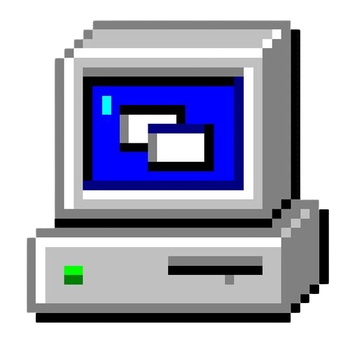

<h1 align="center">Welcome to my profile!</h1>

ようこそ、私のホームページへ。

  
  &nbsp;&nbsp;&nbsp;
  

## Technologies & Tools

  
  
  
  
  
  

  
  
  
  

---

  
  &nbsp;&nbsp;&nbsp;&nbsp;&nbsp;&nbsp;&nbsp;&nbsp;
  
   
  <a href="https://win98.si/">Windows 98</a> &nbsp;&nbsp;&nbsp;&nbsp; <a href="https://winxp.si/">Windows XP</a>

またね。

